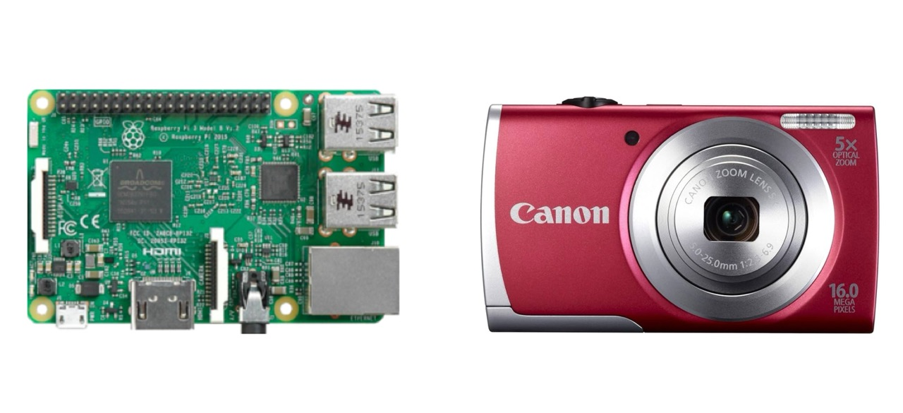

The **Digitization Toolkit** brings together open hardware, [Captua capture software](/project/captua), and practical documentation so lower-resourced institutions, collectives, and communities can digitize their archival collections at low cost. The project asks what changes when collection owners and custodians have the means to make their own digital records: what is worth preserving, who decides, and on what terms the resulting images can be described and shared.

A decade ago, the development and dissemination of "DIY" book scanning equipment dramatically reduced the cost of digitizing bound materials and made possible a broad range of digital humanities research and experimentation, including our own regionally recognized efforts to digitize endangered archives in Latin America. The cheap point-and-shoot digital cameras and single-board hobbyist computers at the heart of these designs (pictured below), however, are increasingly obsolete or unavailable.

Building on a decade of community-based digitization work in the Global South, with a [Level I Digital Humanities Advancement Grant from the National Endowment for the Humanities](https://apps.neh.gov/publicquery/AwardDetail.aspx?gn=HAA-304052-25), we are developing a new generation of equipment and software around available components and openly documented designs. The aim is a system that collection custodians can operate locally, adapt, and maintain, including where internet access is unreliable or unavailable.

## Three connected parts

**The scanner.** An open hardware design combines a book cradle, paired cameras, lighting, and a Raspberry Pi capture unit. The current prototype uses a trestle structure with a counterbalanced capture head and a drawer-style cradle. Designs are developed through successive physical builds, with drawings and observations recorded together. The hardware remains in development; a design offered for replication will follow testing and refinement.

**Captua.** The software runs on the capture unit and provides an English/Spanish interface for organizing projects and volumes, controlling cameras, inspecting captures, and preparing material for review. Capture works offline after the unit has been provisioned. When connected to [Fisqua](/project/fisqua), the unit can receive digitization lists and return captures for quality control; rejected openings come back to the operator with instructions for retaking them. [Read more about Captua](/project/captua).

**Documentation.** Operator cards, camera setup instructions, deployment guides, and hardware design records make the working methods available alongside the code and drawings. They support both the people using a scanner each day and the people responsible for building and maintaining it.

## Development and evaluation

The Level I project brings these parts together into a working prototype for evaluation with the [Santa Barbara Mission Archive-Library (SBMAL)](https://www.sbmal.org). Captua has reached its 0.2.0 release; the scanner's mechanical design continues through assembly and testing. A software release and a reproducible hardware design are separate milestones.

The project is also identifying partners holding traditional and nontraditional collections for a possible next stage of collaboration. Its purpose extends beyond producing a machine: it develops an approach to digitization in which communities retain practical control over their materials and the infrastructure used to preserve them.

The Toolkit connects to AMPL's wider family of tools: Captua captures, [Fisqua](/project/fisqua) catalogs and manages review, [Zasqua](/project/zasqua) publishes, and [Telar](/project/telar) tells stories with the resulting materials. Each tool can also be used independently.

[Captua documentation](https://captua.org/) · [Software source code](https://github.com/UCSB-AMPLab/digitization-toolkit-software)
