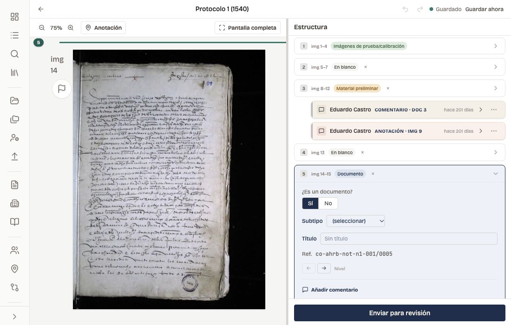
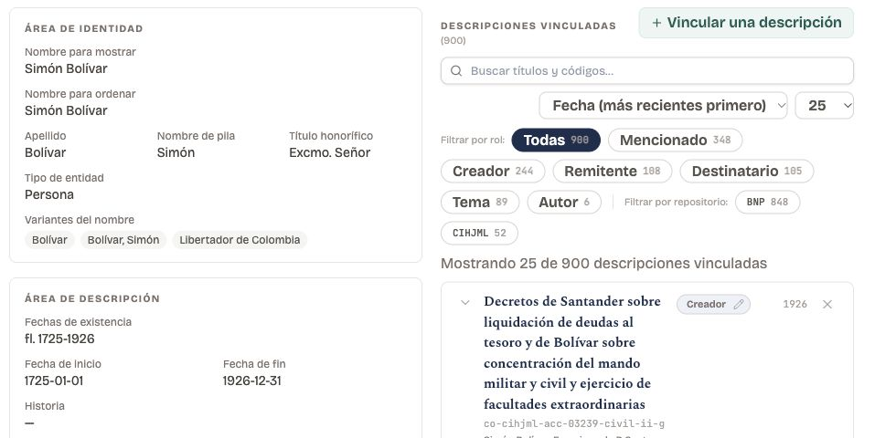

**Fisqua** is AMPL's platform for archives to describe materials, manage records, maintain authorities and controlled vocabularies, and coordinate digitization and publication. Its modular workspaces connect these activities without requiring every archive to adopt the same workflow. It is one of the four open-source tools AMPL develops with its partners, alongside [Captua](/project/captua), which captures, [Zasqua](/project/zasqua), which publishes, and [Telar](/project/telar), which tells. The four are designed to work together as a full pipeline, but each can be used independently — with other tools, or on its own — depending on what an archive needs.

An archive can choose **ISAD(G), DACS, or RAD** as its descriptive standard, with forms and validation following that choice. Authority records follow **ISAAR(CPF)**; images use **IIIF**; and preservation metadata travels in **METS**. Structured imports bring existing catalogs into the workspace, with a preview of proposed changes and a record of the import that can be reviewed and reversed. Publication exports carry descriptions and their links to people, places, and repositories into [Zasqua](/project/zasqua). Working in shared, open formats means that the archive's descriptive work can outlive the software holding it.

One feature at the heart of Fisqua distinguishes it from most archive management platforms: it is designed to open description work to volunteers, students, and community members under professional archival review. This emphasis has come out of more than a decade of practice — working with UCSB undergraduates to catalog endangered archives in Latin America, and with [Neogranadina](https://neogranadina.org)'s network of volunteers around the world — and we call it **Collaborative Cataloging**. A convener assigns items; contributors describe them against the catalog's controlled fields and vocabularies; the convener reviews and approves entries before they enter the catalog. Three things come out of this at once: archival description produced at a scale few institutions can resource on their own; hands-on training in the core skills of historical archival work — paleography, description, and authority work — that are otherwise hard to come by outside professional programs; and a practice of archiving that stays open to the communities and publics whose materials are being described.

<figure class="tool-screenshot">
  
  <figcaption>Identifying documents within a notarial volume: manuscript images, document boundaries, and review comments remain together in the workspace.</figcaption>
</figure>

Fisqua also supports **shared authority work** across partner institutions: people, organizations, places, and vocabularies can be maintained within a federation, while each workspace retains control of its own descriptions and permissions. Review and an operations history make changes to shared records accountable.

<figure class="tool-screenshot">
  
  <figcaption>Authority records connect people and organizations to the descriptions in which they appear, with links that can be explored by role and repository.</figcaption>
</figure>

For archives using **Captua**, digitization review becomes part of the same environment. Scanner units deliver volumes for quality control; reviewers approve openings or request specific retakes with reasons and notes. A volume is held back from processing until its openings have been approved, and retake requests return to the capture unit. This gives the archive a record of the work between taking a photograph and making it available for description and publication.

Fisqua can also coordinate image processing through a separate processing service, recording runs and review decisions while preserving the original captures. Processed volumes can supply IIIF images and page-by-page transcripts for publication. This part of the workflow is enabled and operated separately; it is not required for archival description or collaborative cataloging.

AMPL operates a hosted, multi-tenant [Fisqua](https://fisqua.org) that partners use without maintaining servers of their own. It runs on Cloudflare Workers, D1, and R2 — a minimal-computing stack that keeps the per-workspace infrastructure modest. The complete platform is published as open source so that the infrastructure can be inspected and reused, and partners can leave with their data. AMPL's development and support focus on its hosted partner workspaces; the availability of source code does not imply a supported self-hosting service.

The hosted instance is already in use. It supports the cataloging work of Neogranadina across five partner repositories in Colombia and Peru — ranging from community-held collections to the Peruvian National Library, and comprising over 106,000 archival descriptions in total — as well as AMPL's own cataloging. Further partner deployments are planned through UCSB's [**Robinson Archives Initiative**](https://www.library.ucsb.edu/news/ucsb-receives-robinson-archive), a collaboration with community archives of social movement histories in the United States and beyond. Each partner keeps its own catalog and access permissions within the shared hosted infrastructure.

The name **Fisqua** comes from a Muisca verb meaning *gathering scattered things*, related to forms for searching, gathering, and traversing — a cluster of meanings that describes both the work the tool enables and the historical processes the resulting catalogs help document.

Thank you to [Jairo Melo Flórez](https://jairomelo.com), whose Django-based prosopographical work at Neogranadina and AMPL — developed for the UC MRPI Routes of Enslavement in the Americas project and now powering [Trayectorias Afro](https://trayectoriasafro.org) and the [Sondondo Parish Records Project](https://ampl.clair.ucsb.edu/sondondo) — first bore the name "[Fisqua](https://zenodo.org/records/16332384)".

Source code: [Fisqua on GitHub](https://github.com/UCSB-AMPLab/fisqua).
