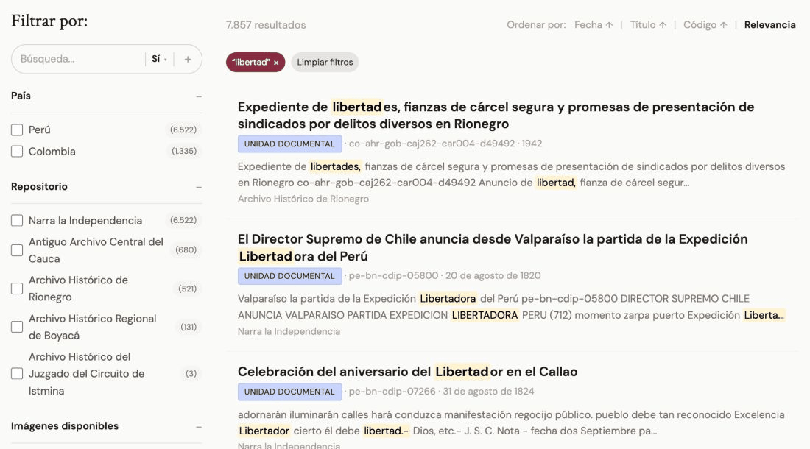
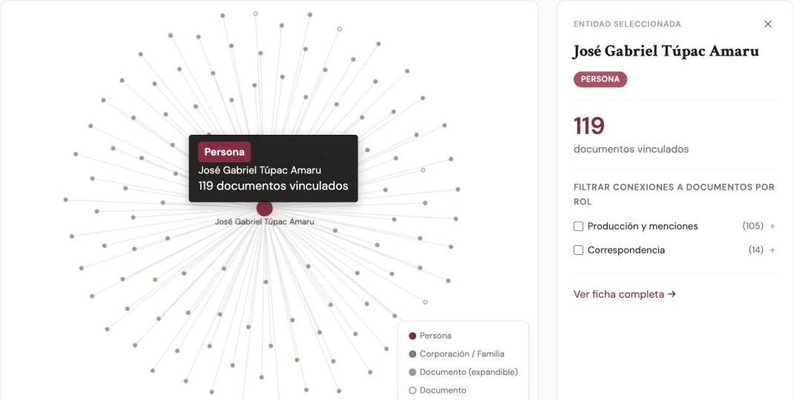
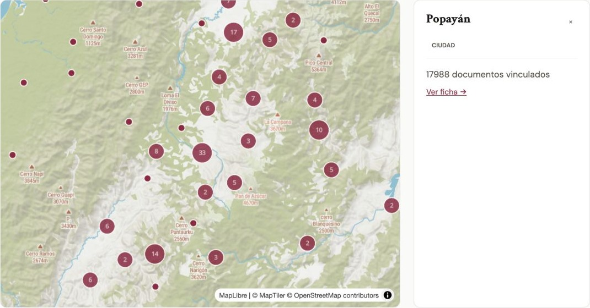
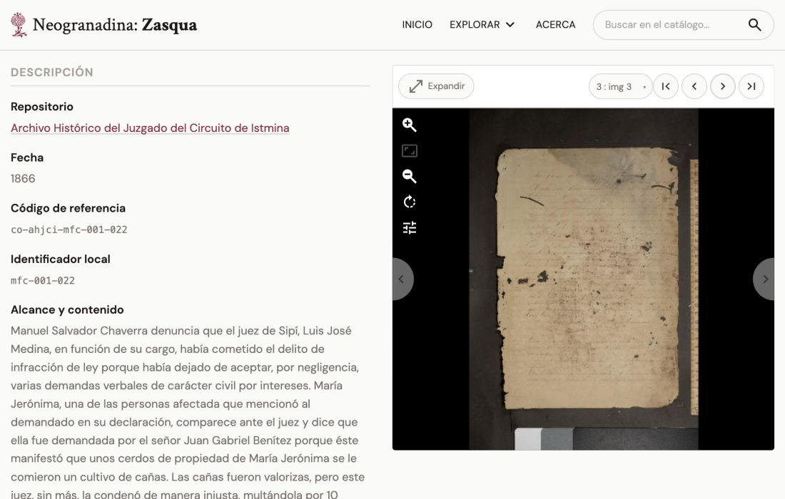

**Zasqua** is AMPL's publication engine for digital archives. It turns archival descriptions, records of people and places, and digitized images into public sites with powerful tools for discovery. Readers can search across collections, combine filters, trace people and institutions through their documents, and explore the geography of an archive. Alongside [Captua](/project/captua) for digitization and [Fisqua](/project/fisqua) for cataloging, Zasqua completes a pipeline from capture to public access. Each tool can also be used independently.

The name **zasqua** is a word in the Muisca language meaning "to place oneself," "to settle," "to remain in a given place or condition" — a verb describing the act of situating something where it belongs. The platform carries this name because that is what it does: it places digitized documentary collections in a stable, open-access space. Documents that were scattered, hard to consult, or at risk of being lost find a place of their own here.[^1]

Most archival discovery platforms depend on application servers, search engines, and databases running at request time. Zasqua takes a different approach, drawing on [minimal computing](https://go-dh.github.io/mincomp/) principles: the entire public site is pre-built as static files. Faceted search runs in the browser using [Pagefind](https://pagefind.app/), while pre-built indexes connect descriptions with people, institutions, and places. Readers can move through these connections without a database serving each request. Images use IIIF Level 0 static tiles for deep zoom without an image server. The result is a site that is fast, cacheable, cheap to host, and resilient. Cataloging happens in a separate tool — [Fisqua](/project/fisqua), AMPL's cataloging primitive, or any compatible producer of ISAD(G) descriptions and IIIF manifests — which exports the data Zasqua consumes. Zasqua's own pipeline compiles the exports into the static site on each deploy; any static host can serve the result. The technical contribution is bringing rich archival discovery to infrastructure that small institutions can sustain.

The engine is separate from any individual archive. Each deployment supplies its own collections, name, and visual identity, and selects the capabilities its data supports: hierarchical browsing, authority records for people and organizations, places and maps, deep-zoom images, and searchable OCR text. A starter template and importers for CSV, EAD3, CollectiveAccess, and Fisqua make the same infrastructure available to collections with different starting points.

**Search across collections.** Full-text search can be combined with filters for country, repository, available images, level of description, and date. Result counts update as filters are applied, helping readers refine a question across collections held by different institutions.

<figure class="tool-screenshot">
  <picture>
    <source media="(prefers-reduced-motion: reduce)" srcset="/images/tools/zasqua-search-poster.jpg">
    
  </picture>
  <figcaption>Search across repositories, then refine the results: selecting Colombia narrows a search for “libertad” while updating the available facets.</figcaption>
</figure>

**Follow people and institutions through the archive.** The entity browser connects authority records with the documents in which they appear. Readers can search names and variants, filter by type, date, or role, and expand a document in the relationship explorer to discover the other people and institutions associated with it.

<figure class="tool-screenshot">
  <picture>
    <source media="(prefers-reduced-motion: reduce)" srcset="/images/tools/zasqua-entities-poster.jpg">
    
  </picture>
  <figcaption>From a person to a document to other people: expanding Túpac Amaru’s marriage record reveals Micaela Bastidas and the other entities connected to that record.</figcaption>
</figure>

**Explore places and their records.** The place browser combines a searchable geographic index with an interactive map. Selecting a place leads to its authority record and linked archival descriptions, connecting geographic exploration with documentary research.

<figure class="tool-screenshot">
  
  <figcaption>Geographic discovery in the place browser: Popayán links to nearly 18,000 documents, while the map makes nearby archival locations available to explore.</figcaption>
</figure>

Zasqua's first deployment is [zasqua.org](https://zasqua.org), the digital archive of the Colombian digital humanities nonprofit [Neogranadina](https://neogranadina.org), developed at AMPL as a successor to the ABC (Archivo, Biblioteca, Catálogo), Neogranadina's earlier platform built on CollectiveAccess. It makes more than 106,000 descriptions from five repositories in Colombia and Peru available through faceted search, entity and place browsers, and IIIF image viewing.

Because the public site is just files — HTML, JSON, and static image tiles — it can be archived, mirrored, or rebuilt from exports with no dependency on a running application or database. The data is not locked into any platform. This matters for collections in lower-resource environments where maintaining servers and databases is not realistic in the long term.

The collections span the colonial and republican periods of Colombia and Peru. The Centro de Investigaciones Históricas "José María Arboleda Llorente" in Popayán holds the Antiguo Archivo Central del Cauca (ACC), with administrative records organized into series including Civil, Judicial, Eclesiástico, and Gobierno. The Archivo Histórico de Rionegro in Antioquia is the largest collection, with over 55,000 descriptions across Concejo, Gobierno, Judicial, and Notarial fonds. The Biblioteca Nacional del Peru contributes the Colección Documental de la Independencia del Perú (CDIP), a published documentary series digitized with OCR. The Archivo Histórico Regional de Boyacá in Tunja holds multiple fonds including notarial records and the Archivo Histórico de Tunja. And the Archivo Histórico del Juzgado del Circuito de Istmina in Chocó holds nineteenth- and twentieth-century judicial records, digitized as part of the [Endangered Archives Programme EAP 1477](https://eap.bl.uk/project/EAP1477). These collections were digitized by Neogranadina and its partners over more than a decade of work in archival preservation.

<figure class="tool-screenshot">
  
  <figcaption>A court record from Istmina brings the archival description and digitized pages into the same view. The images can be enlarged for close reading.</figcaption>
</figure>

Further Zasqua deployments are planned through UCSB's [**Robinson Archives Initiative**](https://www.library.ucsb.edu/news/ucsb-receives-robinson-archive), a partnership with community archives of social movement histories in the United States and beyond. Each partner operates its own Zasqua site under its own name and branding, sharing the primitive and its pipeline but not its data or identity.

The source code is freely available on [GitHub](https://github.com/UCSB-AMPLab/zasqua), alongside a [starter template](https://github.com/UCSB-AMPLab/zasqua-template) and a [guide to building an archive](https://github.com/UCSB-AMPLab/zasqua/blob/main/docs/guide.md).

[^1]: Definition from the [Muysc cubun](https://muysca.cubun.org/zasqua) digital dictionary, maintained by researchers, students, and members of the Muisca communities of Suba and Chía.
